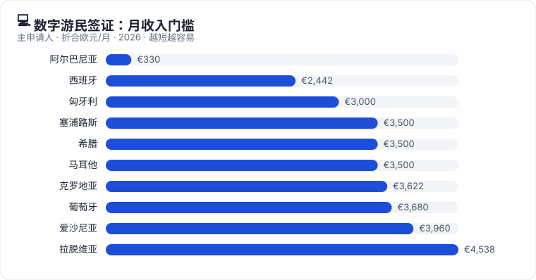
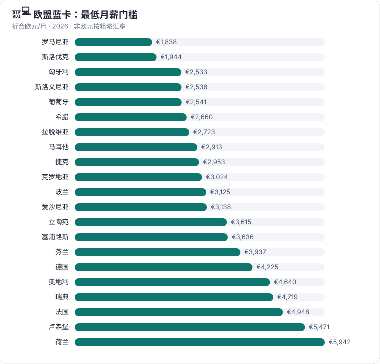
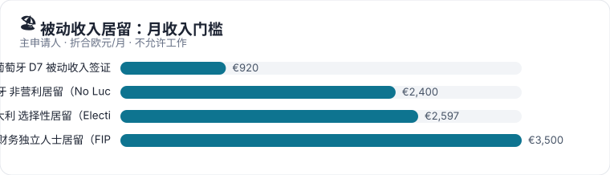
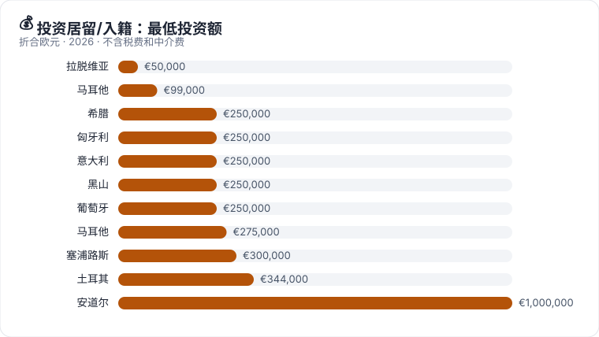
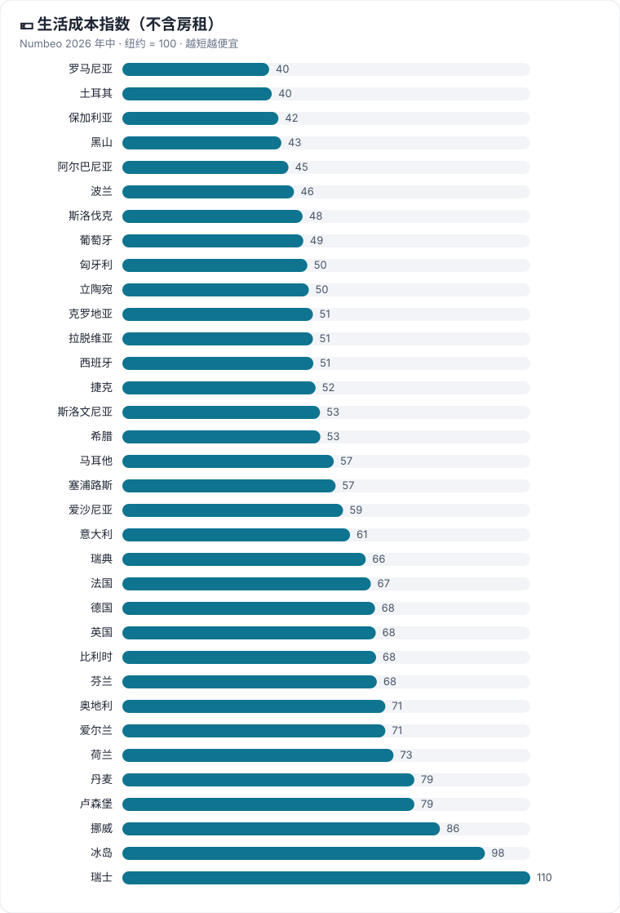

# ⚠️ 本项目为搬运整理版，非原创作品

> **原项目：BryceYuuu/RUN — RUN · 润：海外移居手册**
> **原项目地址：https://github.com/BryceYuuu/RUN**
> **原项目作者：BryceYuuu**
> **数据出处：原项目 + LetsMigrate.org 公开项目记录（详见 SOURCES.md 与 ATTRIBUTION.md）**
> **协议：文档部分沿用原项目 CC BY-SA 4.0（署名 - 相同方式共享）**
>
> 本仓库仅对原项目内容做核对、重排与补充说明，不声称对原手册内容拥有原创著作权。如原作者有异议，请通过 GitHub Issue 联系，本仓库将按要求处理。

---

# Run · 润（优化版）

### 一本海外移居手册的核对整理版

数字游民 · 技术移民 · 欧盟蓝卡 · 创业自雇 · 投资居留

**[🧭 我该走哪条路](docs/routes/choose-route.md)** ｜ **[🌏 主要移民地区](docs/global.md)** ｜ **[🇪🇺 欧洲 36 国](docs/europe.md)** ｜ **[📊 路线对比](docs/europe.md)** ｜ **[📑 文件准备](docs/practical/china-documents.md)**

> [!NOTE]
> **📅 最新更新：2026 年 11 月 3 日**
> - 🇬🇧 **英国永居定案**（11-02）：标准 10 年，高收入 3 / 5 年；学签、毕业生签证、HPI 时间不再计入永居；“十年长居”路线关闭 → [详情](docs/europe/united-kingdom.md)
> - 🇨🇦 **加拿大 Express Entry 新规生效**（11-03）：加拿大工作经验、高薪职业 offer 加分，offer 不再需要 LMIA → [详情](docs/global/canada.md)
> - 🇧🇪 **比利时蓝卡**审理时限缩短为 90 天 → [详情](docs/europe/belgium.md)

> [!CAUTION]
> 本版仅供信息参考，**不构成**移民、法律、税务或投资建议。任何决定前请以各国官方页面为准。完整免责与出处见 [SOURCES.md](SOURCES.md)。

---

## 🚪 你是哪种情况？

| 💻 [数字游民](docs/routes/digital-nomad.md) | 🧑‍💻 [技术工作 · 蓝卡](docs/routes/skilled-work.md) | 🎓 [留学 → 工作 → 移民](docs/routes/study-to-work.md) |
| --- | --- | --- |
| 为境外雇主或客户远程工作，想换个国家生活 15 条欧洲路线 · 月入 €330 起 | 拿到当地雇主 offer：工作 → 居留 → 永居 → 入籍 50+ 条路线 · 最快 21 个月永居 | 毕业后 6–36 个月找工作签证，再转工作签 德国 18 个月 · 芬兰 2 年 · 爱尔兰硕士 2 年 |
| 🚀 [创业 · 自雇](docs/routes/startup-self-employed.md) | 🏖️ [被动收入 · 退休](docs/routes/passive-income.md) | 💰 [投资居留 · 入籍](docs/routes/investment.md) |
| 在当地开公司、做自由职业 爱沙尼亚、爱尔兰 STEP、荷兰、丹麦… | 靠养老金、租金、存款生活，不在当地工作 葡萄牙 D7 €920/月起 · 西班牙 NLV | 用投资换身份，住得少也能保持 希腊 · 塞浦路斯 · 马耳他 · 匈牙利 |

---

## 🌏 主要移民地区

点下面每个目的地，进本版摘要页；摘要页里有原仓库完整页的超链接。

| [🇺🇸 美国](docs/global/usa.md) | [🇨🇦 加拿大](docs/global/canada.md) | [🇦🇺 澳大利亚](docs/global/australia.md) | [🇳🇿 新西兰](docs/global/new-zealand.md) | [🇯🇵 日本](docs/global/japan.md) | [🇰🇷 韩国](docs/global/south-korea.md) | [🇸🇬 新加坡](docs/global/singapore.md) |
| --- | --- | --- | --- | --- | --- | --- |
| [🇭🇰 香港](docs/global/hong-kong.md) | [🇵🇭 菲律宾](docs/global/philippines.md) | [🇹🇭 泰国](docs/global/thailand.md) | [🇲🇾 马来西亚](docs/global/malaysia.md) | [🇦🇪 阿联酋](docs/global/uae.md) | [🌎 拉美](docs/global/latin-america.md) | [🇪🇺 欧洲 36 国](docs/europe.md) |

---

## 🇪🇺 欧洲 36 国

每个国家都有本版摘要页 + 原仓库完整页超链接，完整表见 [docs/europe.md](docs/europe.md)。

| [🇦🇱 阿尔巴尼亚](docs/europe/albania.md) | [🇦🇩 安道尔](docs/europe/andorra.md) | [🇦🇹 奥地利](docs/europe/austria.md) | [🇧🇪 比利时](docs/europe/belgium.md) | [🇧🇬 保加利亚](docs/europe/bulgaria.md) | [🇭🇷 克罗地亚](docs/europe/croatia.md) |
| [🇨🇾 塞浦路斯](docs/europe/cyprus.md) | [🇨🇿 捷克](docs/europe/czechia.md) | [🇩🇰 丹麦](docs/europe/denmark.md) | [🇪🇪 爱沙尼亚](docs/europe/estonia.md) | [🇫🇮 芬兰](docs/europe/finland.md) | [🇫🇷 法国](docs/europe/france.md) |
| [🇩🇪 德国](docs/europe/germany.md) | [🇬🇷 希腊](docs/europe/greece.md) | [🇭🇺 匈牙利](docs/europe/hungary.md) | [🇮🇸 冰岛](docs/europe/iceland.md) | [🇮🇪 爱尔兰](docs/europe/ireland.md) | [🇮🇹 意大利](docs/europe/italy.md) |
| [🇱🇻 拉脱维亚](docs/europe/latvia.md) | [🇱🇮 列支敦士登](docs/europe/liechtenstein.md) | [🇱🇹 立陶宛](docs/europe/lithuania.md) | [🇱🇺 卢森堡](docs/europe/luxembourg.md) | [🇲🇹 马耳他](docs/europe/malta.md) | [🇲🇪 黑山](docs/europe/montenegro.md) |
| [🇳🇱 荷兰](docs/europe/netherlands.md) | [🇳🇴 挪威](docs/europe/norway.md) | [🇵🇱 波兰](docs/europe/poland.md) | [🇵🇹 葡萄牙](docs/europe/portugal.md) | [🇷🇴 罗马尼亚](docs/europe/romania.md) | [🇸🇰 斯洛伐克](docs/europe/slovakia.md) |
| [🇸🇮 斯洛文尼亚](docs/europe/slovenia.md) | [🇪🇸 西班牙](docs/europe/spain.md) | [🇸🇪 瑞典](docs/europe/sweden.md) | [🇨🇭 瑞士](docs/europe/switzerland.md) | [🇹🇷 土耳其](docs/europe/turkiye.md) | [🇬🇧 英国](docs/europe/united-kingdom.md) |

---

## 📈 一图看门槛

图表来自原仓库 `assets/charts/`（CC BY-SA 4.0，署名见下），本版已随仓库一并搬运，可在仓库内直接查看。

| **⚡ 最快拿永居** | **💸 门槛最低** | **🚫 中国大陆护照不适用** |
| --- | --- | --- |
| 🇨🇾 塞浦路斯投资永居 — 直接，约 2 个月 🇲🇹 马耳他 MPRP — 直接 🇩🇪 德国蓝卡 + B1 德语 — 21 个月 🇦🇹 奥地利红白红卡 Plus — 21 个月 🇯🇵 日本高度人才 80 分 — 1 年 | 🇦🇱 阿尔巴尼亚数字游民 — 月入约 €330 🇪🇸 西班牙数字游民 — €2,442/月 🇸🇰 斯洛伐克蓝卡 — €1,944/月 🇵🇱 波兰普通工作许可 — 最低工资即可 🇨🇿 捷克员工卡 — 最低工资即可 | 🇨🇿 捷克数字游民计划 🇯🇵 日本数字游民签证 🇱🇻 拉脱维亚远程工作签证（雇主须 OECD） 🇵🇦 巴拿马友好国家签证 🇺🇸 E-2 条约投资者 |

---

## 📚 实用指南

| 指南 | 内容 |
| --- | --- |
| [🧭 我该走哪条路？](docs/routes/choose-route.md) | 四步判断：收入来源 → 目标 → 护照限制 → 自检清单 |
| [🎓 留学 → 工作 → 移民](docs/routes/study-to-work.md) | 欧洲及全球毕业后找工作签证期限对比 |
| [🏙️ 生活与身份对比表](docs/europe.md) | 36 国生活成本、工资、个税、护照、入籍年限、双重国籍（摘要版，完整表见原仓库） |
| [📑 中国申请人文件准备](docs/practical/china-documents.md) | 海牙认证、无犯罪、学历认证、姓名拼音、资金合规 |
| [🧾 税务居民入门](docs/practical/tax-residency.md) | 居留 ≠ 税务居民；183 天规则；各国特殊税制 |
| [✅ 落地前 90 天清单](docs/practical/landing-checklist.md) | 住址登记、居留卡、税号、银行、续签时间点 |
| [🔗 资源导航](SOURCES.md) | 官方门户、类似网站、其他润学项目 |

---

## 📰 2025–2026 变化时间线

完整时间线见 [docs/changes.md](docs/changes.md)：西班牙黄金签关闭、马耳他投资入籍废止、英国永居新政、加拿大 EE 新规等 18 条。

## 📁 数据出处与署名

- **原始手册**：[BryceYuuu/RUN](https://github.com/BryceYuuu/RUN)，2026-11-03 更新。本版结构、路线清单与大部分门槛数字来自该仓库的两轮逐页检查（欧洲 36 国、路线 7 页、全球 14 页、实务 3 页全部打开）。
- **原始手册的上游**：[LetsMigrate.org](https://letsmigrate.org) 公开项目记录与指南（36 国、99 个项目、284 篇指南），各国页底部共 378 条官方来源。
- **110 条的口径（已核实）**：99（LetsMigrate 对照）+ 11（RUN 自行补充：西班牙 NLV、葡萄牙 D7、德国机会卡、德国技术工人签证、希腊 FIP、意大利选择性居留、马耳他 GRP、爱沙尼亚创业签证、英国技术工作 / 全球人才 / HPI）= 110。
- **本版修正**：马耳他收录 8 条（非 7 条）；黑山、爱尔兰目录按开放路线计；冰岛空列表已标注；被动收入对比表葡 / 西一栏标 ⚠️ 待核对。详见 [VERIFICATION.md](VERIFICATION.md)。
- **协议**：文档部分沿用原仓库的 **CC BY-SA 4.0**，转载本版也要署名并用相同协议共享。
